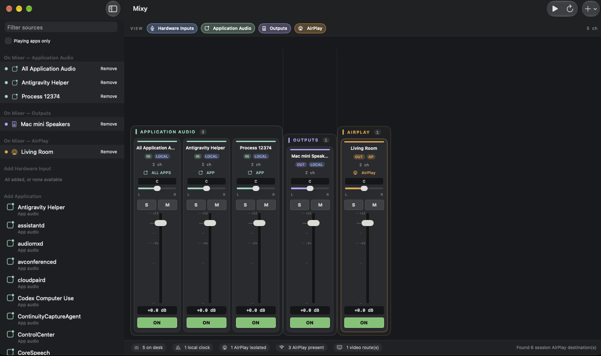

# Mixy



Native macOS system audio mixer. Mix hardware inputs, per-application audio, local outputs, and AirPlay destinations from one desk — without putting AirPlay on a shared sample clock with local devices.

Open `mixy.xcodeproj` and run the **mixy** scheme, or:

```bash
export DEVELOPER_DIR=/Applications/Xcode.app/Contents/Developer
make run
```

Requires **macOS 14.4+**. Built with first-party frameworks only (SwiftUI, Observation, Core Audio, Audio Toolbox, Foundation, AppKit).

## What it does

- **Hardware inputs** — every HAL input (built-in mic, USB/Thunderbolt interfaces, Continuity Capture).
- **Application audio** — per-process Core Audio taps plus “All Application Audio”.
- **Local outputs** — built-in speakers, interfaces, HDMI/DisplayPort, virtual devices.
- **AirPlay** — HAL AirPlay devices plus session Bonjour (`_airplay._tcp` / `_raop._tcp`), isolated onto a high-latency path.
- **Mixer desk** — Logic/Reaper-style include-only channel strips: fader (−96…+12 dB), mute, solo, pan, on/off, I/O reassignment.
- **Mixy Loopback** — first-party 8-channel Audio Server Plug-in so other apps can record the mix.

It is not a DAW. There is no timeline, no insert FX, and no video encoder. Video toggles record a route-selection list for AirPlay/HDMI/DisplayPort destinations.

## Architecture in one picture

```
Inputs (HAL + process taps) ──► StripMix ──► ChannelMixer ──► mix bus
                                                          │
                          local AUHAL (512 frames) ◄──────┤
                                                          │
                          AirPlaySafeBuffer (4096 + 4096) ┘
```

AirPlay never joins a Core Audio aggregate with built-in or music-interface devices. Details and diagrams: [docs/ARCHITECTURE.md](docs/ARCHITECTURE.md).

## Targets

| Target     | Product           | Bundle ID           |
|------------|-------------------|---------------------|
| mixy       | `mixy.app`        | `com.mixy.app`      |
| MixyHAL    | `MixyHAL.driver`  | `com.mixy.MixyHAL`  |
| mixyTests  | hosted XCTest     | `com.mixy.app.tests`|

## Documentation

| Doc | Contents |
|-----|----------|
| [docs/USER_GUIDE.md](docs/USER_GUIDE.md) | Using the desk, menus, permissions |
| [docs/ARCHITECTURE.md](docs/ARCHITECTURE.md) | Layers, signal flow, MixyHAL, diagrams |
| [docs/DEVELOPMENT.md](docs/DEVELOPMENT.md) | Build, test, probes, Xcode MCP |
| [docs/QA.md](docs/QA.md) | Latest full QA results |

## Quick test

```bash
export DEVELOPER_DIR=/Applications/Xcode.app/Contents/Developer
make test
```

66 unit tests cover mix math, strip controls, AirPlay isolation, catalogs, desk grouping, and the shipped AUHAL callback path.
