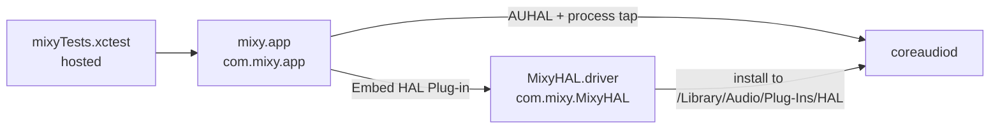
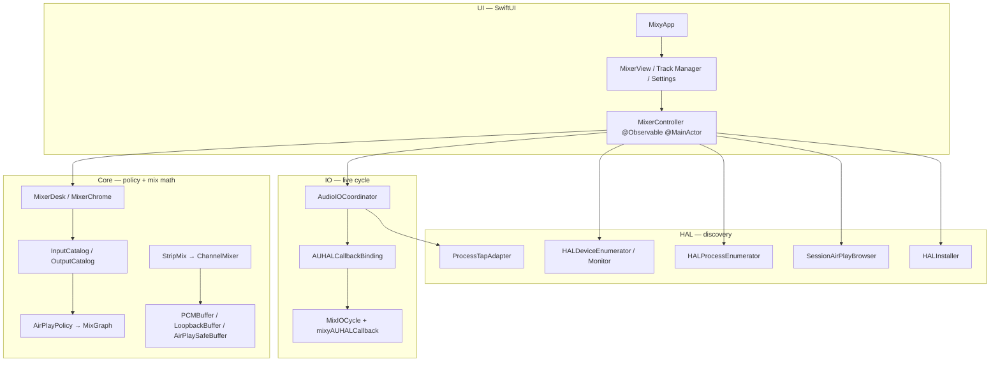
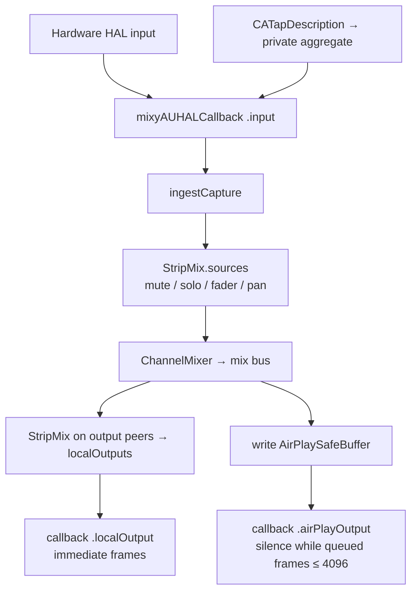
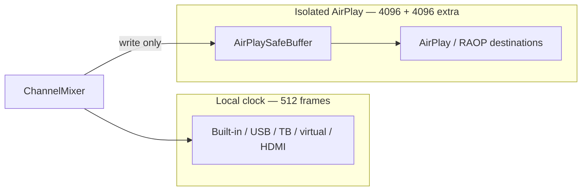

# Mixy architecture

Mixy is a native **macOS 14.4+** mixer (`com.mixy.app`). You include hardware mics, application-audio taps, local HAL outputs, and AirPlay destinations as channel strips, then mix them live through AUHAL.

Visual diagrams (SVG):

- [Layered architecture](diagrams/layered-architecture.svg)
- [Audio signal flow](diagrams/audio-signal-flow.svg)
- [AirPlay isolation](diagrams/airplay-isolation.svg)

---

## Targets



| Target | Product | Role |
|--------|---------|------|
| **mixy** | `mixy.app` | SwiftUI desk + I/O coordinator |
| **MixyHAL** | `MixyHAL.driver` | 8-channel virtual loopback Audio Server Plug-in |
| **mixyTests** | hosted XCTest | 66 cases against the shipped mix path |

Deployment **14.4**. Swift 5. Ad-hoc signing. Sandbox on. MixyHAL is a build dependency of mixy and is copied into `Contents/PlugIns/`.

---

## Layers



**Rule:** classification never comes from UI state. Kind is derived from HAL transport type and channel counts (`DeviceClassifier`).

---

## Runtime objects

### Controller

`MixerController` owns:

- `devices`, `inputSources`, `destinations`
- `strips` (included channels only)
- `graph` (`MixGraph`) and `inputGraph`
- `selectedAudioUIDs` / `selectedVideoUIDs` / `videoRoutes`
- `AudioIOCoordinator`, `HALDeviceMonitor`, `SessionAirPlayBrowser`

It rebuilds catalogs when HAL or Bonjour changes, seeds the desk once (built-in mic and built-in speakers when present, otherwise the first hardware input and the first non-AirPlay output), and pushes the enabled graph into the coordinator on every strip edit.

### Catalogs

| Catalog | Sources | Notes |
|---------|---------|--------|
| `InputCatalog` | HAL inputs + `app:system-wide` + one row per `kAudioHardwarePropertyProcessObjectList` | Mixy’s own pid is skipped |
| `OutputCatalog` | HAL outputs + session AirPlay/RAOP | Dedupes by UID or same-name AirPlay; unions `supportsVideo` |

Application UIDs (`app:{bundleID}:{pid}`, and `app:system-wide`) are **never** treated as outputs (`InputRouter.isTreatedAsOutput`).

### Desk

`MixerDesk` groups included strips into four banks:

1. Hardware Inputs
2. Application Audio
3. Outputs
4. AirPlay

Available catalogs omit UIDs already on the desk. Reassigning a strip (`MixerDesk.transferringControls`) keeps fader, mute, solo, pan, and enabled.

---

## Audio signal flow



See [audio-signal-flow.svg](diagrams/audio-signal-flow.svg).

### Strip processing

Shared by UI, tests, and AUHAL (`StripMix`):

- **Off** or **mute** → linear gain 0.
- **Solo** is directional: if any enabled peer in the same I/O direction is soloed, non-soloed peers go to 0.
- **Fader**: dB, UI range −96…+12. Linear via `AmplitudeGain` (silence floor −96 dB).
- **Pan**: `[-1, 1]`. Linear balance on dest channels 0 and 1; extra channels get unity × gain.
- **Map**: `channelMap[dest] = src` or `-1`. A 1-channel source expands to `[0, 0]` for stereo before pan.

Mix bus width is `max(2, enabled-strip role channel counts, enabled-strip map lengths, capture widths)`. An input strip contributes `inputChannelCount`; an output strip contributes `outputChannelCount`. Duplex interfaces open input units at `inputChannelCount` and output units at `outputChannelCount`.

### AUHAL format

48 kHz, Float32, **non-interleaved**. Input uses `kAudioOutputUnitProperty_SetInputCallback`; outputs use `kAudioUnitProperty_SetRenderCallback`. The C proc is `mixyAUHALCallback`. `stop()` keeps `HALIOContext` objects alive until after `AudioComponentInstanceDispose` so the unretained callback ref cannot UAF.

`LiveMixStarter` (used by `MIXY_START_MIX=1`) enables built-in output devices. Continuity and wireless devices stay off this unattended path; those inputs can stall `AudioUnitInitialize`.

---

## AirPlay isolation

AirPlay has its own clock and large jitter. Sharing a local aggregate with USB or built-in devices glitches or fails configuration.



`AirPlayPolicy.buildGraph`:

- enabled AirPlay UIDs → `isolatedAirPlayUIDs`
- every other enabled output → `localClockDeviceUIDs`
- `localAggregateUIDs(including:)` **throws** `MixPolicyError.airPlayCannotJoinLocalClock`

Constants:

```
AirPlayPolicy.localBufferFrames         = 512
AirPlayPolicy.airPlayBufferFrames       = 4096
AirPlayPolicy.airPlayExtraLatencyFrames = 4096
AirPlaySafeBuffer.frameCapacity         = max(16384, extra + 4096)
```

`MixIOCycle` writes AirPlay destinations into `AirPlaySafeBuffer` only. The AirPlay hardware callback is the sole consumer (`pullAirPlay`). While the ring holds `extraLatencyFrames` or fewer, the callback emits zeros. A later read returns only the surplus above that cushion.

Session endpoints that are not yet HAL devices still enter the graph via `OutputDestination.asDeviceRecord` (AirPlay transport). `makeHALUnit` returns nil if there is no `AudioObjectID` yet — the strip is armed, the unit opens when the system publishes the device.

---

## Application audio

`HALProcessEnumerator` lists `kAudioHardwarePropertyProcessObjectList` (PID, bundle ID, `IsRunningOutput`).

`ProcessTapAdapter.activate`:

1. `CATapDescription`
   - system-wide: `stereoGlobalTapButExcludeProcesses: []`, name `Mixy All Application Audio`
   - per-app: `stereoMixdownOfProcesses: [processObjectID]`
   - `isPrivate = true`, `muteBehavior = .unmuted`
2. `AudioHardwareCreateProcessTap`
3. Private aggregate `mixy.tap.{sourceUID}` with `TapAutoStart` and the tap UID
4. `AudioHardwareCreateAggregateDevice`

Those aggregates are **not** in `kAudioHardwarePropertyDevices`. `AudioIOCoordinator.start` passes `ProcessTapAdapter.inputDeviceID` into `makeHALUnit(..., deviceID:)`. Teardown destroys the aggregate, then the tap.

---

## MixyHAL loopback

First-party **Audio Server Plug-in** (not AudioDriverKit). Loaded by `coreaudiod`. One virtual box + duplex device **Mixy Loopback**.

| Constant | Value |
|----------|--------|
| Device UID | `MixyHALDevice_UID` |
| Device name | `Mixy Loopback` |
| Bundle | `com.mixy.MixyHAL` |
| Channels | 8 |
| Ring | 4096 frames |
| Rates | 44.1 kHz, 48 kHz (default 48 k) |
| Factory UUID | `9C2E4F71-8A3B-4D6C-B1E0-5F7A9C2D4E81` → `MixyHAL_Create` |
| Type UUID | `443ABAB8-E7B3-491A-B985-BEB9187030DB` |

Format: packed native-endian Float32, 8 ch, 32 bytes/frame. `WriteMix` fills the ring (× output volume/mute); `ReadInput` plays it back lagged by the current I/O buffer (× input volume/mute). Transport is virtual → allowed on the local clock.

Install path: **Devices → Install Mixy Loopback Device…** copies the embedded driver to `/Library/Audio/Plug-Ins/HAL/MixyHAL.driver`. Restart `coreaudiod` or log out. Sandbox/admin failure is expected from the in-app menu.

The in-process `LoopbackBuffer` (8 × 8192) used by tests is **not** the plugin ring.

---

## Video routing

Selection only. No AVFoundation session, no encoder.

`supportsVideo` is true for HAL AirPlay / HDMI / DisplayPort, and for `_airplay._tcp` session endpoints. `_raop._tcp` is audio-only. Track Manager shows a Video toggle; the status bar shows selected count. Inventory JSON includes `videoRoutes`.

---

## Permissions

**Entitlements** (`mixy/Mixy.entitlements`): sandbox, audio-input, microphone, network client, user-selected files read-only, `temporary-exception.audio-unit-host`.

**Info.plist**: Bonjour `_airplay._tcp` + `_raop._tcp`, local-network usage, microphone usage, audio-capture usage (process taps).

---

## Key types

| Type | File | Role |
|------|------|------|
| `DeviceRecord` / `DeviceKind` | `Core/DeviceRecord.swift` | HAL snapshot + kind |
| `AirPlayPolicy` / `MixGraph` | `Core/AirPlayPolicy.swift` | Clock grouping + buffers |
| `InputSource` / `InputCatalog` | `Core/InputSource.swift` | Hardware + app inputs |
| `OutputDestination` / `OutputCatalog` | `Core/OutputDestination.swift`, `OutputCatalog.swift` | HAL + session outputs |
| `AudioVideoRouter` | `Core/AudioVideoRouter.swift` | Audio graph + video record |
| `StripMix` / `ChannelMixer` | `Core/StripMix.swift`, `ChannelMixer.swift` | Controls → PCM |
| `MixerDesk` / `MixerChrome` | `Core/MixerDesk.swift`, `MixerChrome.swift` | Banks + paint tokens |
| `AudioIOCoordinator` | `IO/AudioIOCoordinator.swift` | Units, taps, cycle |
| `MixIOCycle` | `IO/MixIOCycle.swift` | Capture → mix → route |
| `ProcessTapAdapter` | `HAL/ProcessTapAdapter.swift` | App audio capture |
| `HALInstaller` | `HAL/HALInstaller.swift` | Copy MixyHAL.driver |
| `MixyHAL_Create` | `MixyHAL/MixyHAL.c` | CFPlugIn factory |
